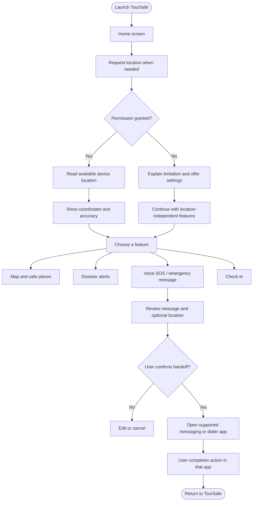

# TourSafe 🧭
### A travel-safety companion for more confident journeys

TourSafe is an Android application prototype focused on helping travellers access safety-related information and emergency actions from one place. It brings together location awareness, nearby-place discovery, disaster-alert presentation, multilingual UI, and an SOS workflow designed around explicit user confirmation.

> **Project status:** Active development / prototype. Feature availability depends on the current build, device permissions, and data sources. Some places or alerts may be demonstration data. Do not use this prototype as a substitute for official emergency services.

## Contents
- [Overview](#overview)
- [Core capabilities](#core-capabilities)
- [Architecture](#architecture)
- [Application flowchart](#application-flowchart)
- [Technology stack](#technology-stack)
- [Project structure](#project-structure)
- [Getting started](#getting-started)
- [Command-line build and install](#command-line-build-and-install)
- [Privacy and safety](#privacy-and-safety)
- [Localization](#localization)
- [Testing checklist](#testing-checklist)
- [Development workflow](#development-workflow)
- [Roadmap](#roadmap)
- [Contributing](#contributing)
- [License](#license)

## Overview

Travellers may need to find useful places, understand local alerts, share their location with someone they trust, or prepare an emergency message quickly. TourSafe aims to make these actions easier to discover through a clear, accessible Android interface.

### Design principles
- **Safety before decoration:** emergency actions should be easy to find and understand.
- **User consent:** show the user what will be shared and let them confirm before handing off to another app.
- **Honest status:** distinguish prepared messages from messages actually sent or delivered.
- **Data transparency:** identify demonstration content and avoid presenting unverified information as official.
- **Privacy by design:** request permissions only when needed and explain why they are requested.
- **Localization:** support travellers using different languages.

## Core capabilities

The following describes the project's feature areas. Verify each feature on the build you distribute before describing it as production-ready.

| Area | Purpose | Important limitation |
|---|---|---|
| Home | Entry point for safety information and shortcuts | Safety status must be based on trustworthy data |
| Location | Request device location and display coordinates/accuracy when available | Requires permission and an enabled location provider |
| Map and places | Present markers or nearby-place information | A working live map and verified place database must be confirmed separately |
| Disaster alerts | Display alert information by severity and location | Mock alerts must never be presented as official live alerts |
| Voice SOS | Use speech recognition to prepare an emergency message | Recognition availability varies by device and language |
| SOS handoff | Review a message and optionally include location before opening a supported messaging or calling app | Opening another app does not prove a message was sent/delivered or a call completed |
| Check-ins | Support a check-in workflow with trusted contacts | Do not claim delivery/receipt without confirmation |
| Settings | Configure language, profile, permissions, and other available preferences | Persistence depends on the current implementation |

## Architecture

TourSafe is a native Android project built with Kotlin and Jetpack Compose. The intended separation of responsibilities is:

- **UI layer:** Compose screens and reusable components render state and forward user actions.
- **Presentation/state layer:** ViewModels expose screen state and coordinate user actions.
- **Domain/model layer:** models represent alerts, places, and app concepts; utility functions handle calculations such as distance.
- **Platform integration:** Android APIs handle runtime permissions, location, speech recognition, and intents to other applications.
- **Data layer:** prototype/mock data may be used where a verified backend or official source is not integrated.

The exact package boundaries may evolve. Check the current source tree before relying on this diagram as a literal package map.

## Application flowchart



## Technology stack

| Technology | Role |
|---|---|
| Kotlin | Primary application language |
| Android SDK | Device APIs, permissions, and lifecycle |
| Jetpack Compose | Declarative UI |
| Material 3 | UI components and visual system |
| ViewModel / StateFlow (where used) | UI state and state updates |
| Android location APIs | Device location, subject to permissions/provider availability |
| Android `SpeechRecognizer` (where enabled) | Voice-to-text input |
| Android intents | Handoff to messaging, dialer, or map applications |
| Gradle | Build automation |
| Git and GitHub | Version control and collaboration |

Do not assume a backend or external API exists unless it is configured and documented in the current branch. Never commit API keys, signing credentials, local SDK configuration, or other secrets.

## Project structure

Typical Android project layout:

```text
Tour-Safe/
├── app/
│   ├── build.gradle.kts
│   └── src/
│       ├── main/
│       │   ├── AndroidManifest.xml
│       │   ├── java/com/toursafe/
│       │   │   ├── [application and feature packages]
│       │   │   ├── [screens and reusable UI]
│       │   │   ├── [ViewModels and state]
│       │   │   ├── [models and utilities]
│       │   │   └── [location / SOS integration]
│       │   └── res/
│       │       └── values*/strings.xml
│       ├── test/
│       └── androidTest/
├── gradle/
├── gradlew
├── gradlew.bat
├── build.gradle.kts
├── settings.gradle.kts
├── gradle.properties
└── README.md
```

This is a guide to a typical layout, not a guarantee that every package already exists. The repository itself is authoritative.

## Getting started

### Requirements
- Android Studio compatible with the project's Gradle and Android Gradle Plugin versions
- A compatible JDK (use the JDK configured for this project)
- Required Android SDK platform and build tools
- Android device or emulator
- Git (optional, for cloning and contributing)

### Clone the repository

Replace `<repository-url>` with the actual GitHub repository URL:

```bash
git clone <repository-url>
cd Tour-Safe
```

Open the project in Android Studio, allow Gradle sync to finish, then run the `app` configuration on an emulator or connected device.

## Command-line build and install

Run from the repository root.

**Windows Command Prompt**
```cmd
gradlew.bat assembleDebug
```

**PowerShell**
```powershell
.\gradlew assembleDebug
```

**macOS / Linux**
```bash
./gradlew assembleDebug
```

If the build succeeds, the debug APK is typically located at:

```text
app/build/outputs/apk/debug/app-debug.apk
```

Check that a connected device is authorized, then install:

```bash
adb devices
adb install -r app/build/outputs/apk/debug/app-debug.apk
```

On Windows, this path also works in Command Prompt:

```cmd
adb install -r app\build\outputs\apk\debug\app-debug.apk
```

A debug APK is for development/testing. For distribution, create a properly signed release APK or Android App Bundle and protect the signing key. Never commit signing keys or passwords.

## Privacy and safety

Depending on enabled features, the app may request approximate/precise location and microphone access for voice input. Request permissions in context, explain their purpose, and keep the app usable where possible if a permission is denied. Do not add background location access without a justified feature and appropriate policy compliance.

Before sharing location or a message:
1. Show the message and location details that will be included.
2. Allow the user to edit, omit location, or cancel.
3. Require an explicit action to hand off to another application.
4. Explain that the user may still need to press Send or complete the call in that application.

### Data integrity requirements
- Clearly label mock/demo alerts and places.
- Do not invent emergency phone numbers, official warnings, safety scores, ratings, or availability.
- Do not silently send messages or share GPS coordinates.
- Do not report an SMS as sent/delivered merely because a messaging app was opened.
- Do not report a call as completed merely because the dialer was opened.
- Handle missing location, denied permissions, offline conditions, and speech-recognition errors clearly.
- Prefer official, attributable data sources for future real-time alerts or verified services.
- Provide an appropriate privacy policy before collecting or sharing personal data in a public release.

**TourSafe is not a replacement for local emergency services or official government alerts.** Users should follow local authorities' instructions during an emergency.

## Localization

The planned language set is:
- English
- हिन्दी — Hindi
- Español — Spanish
- Français — French
- Deutsch — German
- 简体中文 — Simplified Chinese
- 日本語 — Japanese
- ไทย — Thai

Keep user-facing text in Android string resources instead of hardcoding it in Kotlin. Check all locales for translation coverage, formatting placeholders, plural forms, accessibility labels, and longer translated text. A locale folder alone does not guarantee complete translation coverage.

## Testing checklist

Before sharing a build, verify on a real device where possible:

- [ ] App launches and main navigation works.
- [ ] Location permission granted, denied, and approximate-only paths behave correctly.
- [ ] Location unavailable/offline states are understandable.
- [ ] Voice input works where supported; editing and fallback remain usable.
- [ ] SOS message and optional location are previewed before handoff.
- [ ] The UI never claims message delivery or call completion without confirmation.
- [ ] Check-in status accurately represents what happened.
- [ ] Demo content is visibly labelled and cannot be mistaken for verified live information.
- [ ] All eight language selections and important screens are checked.
- [ ] Text scaling, contrast, touch targets, and TalkBack labels are reviewed.
- [ ] Build succeeds and relevant tests pass.
- [ ] No secrets, local SDK files, or signing credentials are tracked by Git.

## Development workflow

Use feature branches and small, reviewable commits:

```bash
git status
git switch -c feature/short-description
# Make and test changes
git diff
git add <files>
git commit -m "Describe the change"
git push -u origin feature/short-description
```

Before pushing, inspect staged changes and confirm that no secrets, generated build outputs, or machine-specific configuration files are included.

## Roadmap

Potential next steps, depending on project priorities:
- Complete a consistent, accessible UI across screens.
- Verify real-device location and SOS flows.
- Add unit tests for distance calculations, message construction, and state logic.
- Add localization parity checks across all supported languages.
- Integrate a real map and trustworthy place/alert data sources where feasible.
- Add secure persistence for settings and emergency contacts.
- Establish a privacy policy, data retention policy, and release checklist before public launch.
- Conduct usability and safety testing with travellers.

## Contributing

Contributions and issue reports are welcome. Please include:
- A clear description of the issue or proposed change
- Reproduction steps and device/Android version for bugs
- Screenshots or a short recording for UI issues (remove personal information)
- Build/test results
- Notes about permissions, privacy, localization, or emergency-flow impact

For safety-sensitive changes, explain how the behavior was tested and what the app tells the user when the operation cannot be completed.

## License

No license is specified here. Until a license is added to the repository, do not assume that the code is available for unrestricted reuse. Add a suitable `LICENSE` file once the project owner has chosen the terms.

---

<p align="center">
  Built with care for safer journeys. 🧭
</p>
